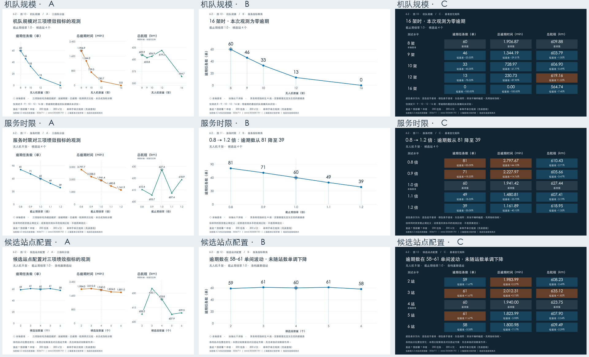

# 当前稿 6.2 敏感性分析 PPT 候选图

本图集依据 `writing/manuscript/低空物流协同调度_示意数据修订版.docx` 的 6.2，提供 **3 个主题 × 3 个版本，共 9 张图**。每张含 3840 × 2160 PNG 和矢量 SVG，均为 16:9；另有可离线打开的[交互候选总览](index.html)和[九图缩略总览](candidate-overview.png)。GitHub 文件页不执行 HTML，下载本目录后打开 `index.html` 即可使用。



## 汇报时怎么选

| 版本 | 呈现方式 | 适用场景 |
|---|---|---|
| A 三指标分面 | 同时保留逾期任务数、总逾期时间、总航程及五个测试水平 | 方法汇报、答辩追问和附录。总航程用明确标注的局部纵轴，另外两轴从零起点展示 |
| B 服务指标聚焦 | 大号逾期数、实际数值横轴、零起点 | 主讲页首选：机队规模和服务时限的方向最清楚；三项完整绩效仍需参考 A/C |
| C 基准变化矩阵 | 深色大屏版，五水平的三指标绝对值与相对本轴基准变化同时展示 | 站点配置主讲页首选，便于看到 5 站的逾期数升高而总逾期、航程下降的取舍；也适合其他主题的大屏汇报 |

推荐组合：**机队 B + 服务时限 B + 站点 C**，三张 A 放附录。C 的蓝/橙底色只表示低于/高于本轴基准，深浅不编码幅度。三项指标按逾期数、总逾期时间、总航程依次比较，没有构造加权总分。

## 图文件

| 对应论文 | A 三指标 | B 主指标 | C 基准矩阵 |
|---|---|---|---|
| 图10 机队规模 | [PNG](png/drone_count_a_facets.png) · [SVG](svg/drone_count_a_facets.svg) | [PNG](png/drone_count_b_service.png) · [SVG](svg/drone_count_b_service.svg) | [PNG](png/drone_count_c_matrix.png) · [SVG](svg/drone_count_c_matrix.svg) |
| 图11 服务时限 | [PNG](png/deadline_multiplier_a_facets.png) · [SVG](svg/deadline_multiplier_a_facets.svg) | [PNG](png/deadline_multiplier_b_service.png) · [SVG](svg/deadline_multiplier_b_service.svg) | [PNG](png/deadline_multiplier_c_matrix.png) · [SVG](svg/deadline_multiplier_c_matrix.svg) |
| 图12 候选站点配置 | [PNG](png/station_count_a_facets.png) · [SVG](svg/station_count_a_facets.svg) | [PNG](png/station_count_b_service.png) · [SVG](svg/station_count_b_service.svg) | [PNG](png/station_count_c_matrix.png) · [SVG](svg/station_count_c_matrix.svg) |

## 数据来源与版本边界

当前稿数值精确对应历史提交 **[`303e711ec9287c11e8f544bae850a95cab0dc8d4`](https://github.com/vegetarianwolf/JD_WuLiuBei/tree/303e711ec9287c11e8f544bae850a95cab0dc8d4)** 的 [final_sensitivity/runs.csv](https://github.com/vegetarianwolf/JD_WuLiuBei/blob/303e711ec9287c11e8f544bae850a95cab0dc8d4/algorithm/results/final_sensitivity/runs.csv)，不对应当前工作树中的同名文件。数据快照、哈希和引用清单分别保存在 [historical_runs.csv](data/historical_runs.csv)、[historical_manifest.json](data/historical_manifest.json)、[source_audit.json](data/source_audit.json)。

本批为直送 + 预部署 + 中继的组合策略，200 项任务，种子 `2026081701`，每档 300 s，三轴各五档、共 15 次单独求解。15 行 CSV、已保存 JSON 得分和 15 份完整解的 SHA-256 均已核对。数据核验只重读保存证据，未重新运行求解器，未宣称本次重新评估了路线可行性。论文和既有实验记录保持不变，6.1.2 的示意数据未进入图集。

| 参数轴 | 水平 | 当前稿对应逾期数 |
|---|---|---|
| 无人机数量 | 8 / 9 / 10 / 12 / 16 架 | 60 / 46 / 33 / 13 / 0 |
| 截止期倍率 | 0.8 / 0.9 / 1.0 / 1.1 / 1.2 倍 | 81 / 71 / 60 / 49 / 39 |
| 候选站点配置 | 2 / 3 / 4 / 5 / 6 站，分别选址 | 59 / 61 / 60 / 61 / 58 |

**不能与后续批次混用。** 当前工作树 `final_sensitivity` 已改为四策略、五种子、300 s 的统计；新 `section62_shared_20261015T025130Z` 则为单组合策略、三种子、240 s，采用固定六站的嵌套子集，并复用共同基准。例如机队轴 8 架基准：

| 数据版本 | 逾期数（单） | 总逾期（min） | 航程（km） |
|---|---:|---:|---:|
| 当前稿历史单次值，本图采用 | 60 | 1906.8653 | 609.8763 |
| 当前工作树五种子均值，未采用 | 61.4 | 1927.2440 | 617.4273 |
| 新共享方案三种子均值，未采用 | 65.3333 | 2067.7139 | 632.1388 |

完整逐水平差异见 `data/source_audit.json` 的 `all_axes_cross_batch_comparison`。历史路径先在 `40985c3` 改为四策略单种子，再在 `bb1be40` 改为四策略五种子，故复现本图必须固定历史提交。

## 必须保留的解释范围

- 每档 **n=1**，没有 SD、置信区间或显著性检验。图上的点是已保存的单次结果；连接线只是帮助阅读，不表示拟合或未测档位的预测。
- 三条轴都写基准配置 `(8 架, 1.0 倍, 4 站)`，但分别求解。机队轴基准 T/L 为 `1906.865312563578 / 609.8763326252944`，时限轴为 `1941.4151593395857 / 627.4418545200368`，站点轴为 `1939.999882723483 / 623.7541350103868`。C 版只相对自己轴的基准计算，不能合并成共享解。
- 历史站点轴每档重新执行加权 k-medoids，站点坐标随数量改变，属于数量及对应选址方案的共同变化；不能只归因为站数。新批次的嵌套站点设计没有套用到旧数据。
- 机队只测 8、9、10、12、16 架，不能把 16 架宣称为“最低零逾期机队”；13–15 架未测试。放宽截止期也改变了问题定义，不据此主张因果效应。
- 当前稿的图10–12是不同于历史原图的中文位图，部分点位存在读图偏移。本图按与正文匹配的历史精确数据重绘，不从像素反算。尤其倍率 1.1 的航程使用原值 **607.4097188492149 km**。原稿 6.2.2/6.2.3 中两处“如图10”分别应对图11/12；本任务仅记录，不改论文。
- 历史 manifest 的 `git_dirty=true`，且定时启发式运行受机器负载影响。本目录复现的是已保存结果的图，不保证重跑实验逐位得到同一结果。

## 复现与核验

先在包含历史 Git 对象的完整仓库里验证数据，再生成图和总览。只读取既有数据，不运行新实验：

```bash
python3 writing/figures/section62_ppt_20261015/validate_data.py
MPLCONFIGDIR=/tmp/section62-mpl .venv/bin/python writing/figures/section62_ppt_20261015/build_figures.py
python3 writing/figures/section62_ppt_20261015/build_gallery.py
```

绘图依赖 Matplotlib、NumPy、Pillow；中文字体默认检测 macOS 黑体，也支持 Noto Sans CJK、思源黑体、微软雅黑或 `FONT_PATH=/path/to/font.ttf`。SVG 文字转轮廓以避免跨平台缺字，修改文字应改 Python 源码重绘。PNG 为 3840 × 2160、240 dpi；SVG 可以按需缩放。无需 PPT 软件或联网服务。

[validation.json](data/validation.json) 记录原始数据与已保存解核验；[render_checks.json](render_checks.json) 记录九图画布尺寸、字体、依赖版本和文本边界自动检查；视觉检查与交互检查记录见 [QA.md](QA.md)。本目录没有新实验、论文替换或轻量 PPT 图集。
